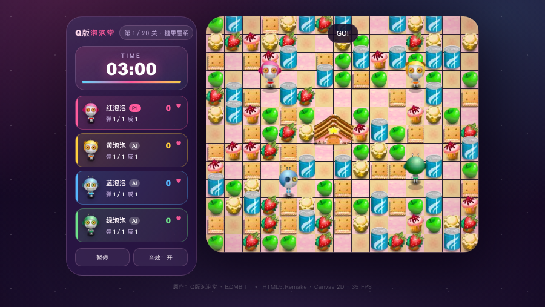

# PopBomb Arena — Q版泡泡堂 HTML5 重制

经典 Flash 炸弹人对战游戏 **《Q版泡泡堂》（BOMB IT）** 的非官方 Web 重制版。使用原生 Canvas 2D + HTML/CSS/JavaScript 实现，无构建步骤、无第三方运行时，完整复刻原作的 35 fps 逐格逻辑、地图生成、AI、道具与关卡流程。

> 本项目与原作者、发行商无关联，仅用于学习与怀旧。原始 SWF 与提取素材的版权归各自权利人所有。




---

## 快速开始

项目是纯静态页面。由于浏览器对本地文件（`file://`）的音频和资源加载有限制，请用任意静态服务器启动：

```bash
cd flash-game
python3 -m http.server 8000
```

然后打开：

```text
http://127.0.0.1:8000/
```

也可以使用：

```bash
npx serve .
# 或
php -S 127.0.0.1:8000
```

无需 `npm install`，无需打包。现代 Chrome / Edge / Firefox / Safari 均可运行。

> 首次点击或按键后才会播放声音，这是浏览器的自动播放策略。

---

## 操作

| 模式 | 移动 | 放炸弹 / 使用武器 |
|---|---|---|
| 单人 | `↑` `←` `↓` `→` | `Space` |
| 双人 · P1 | `W` `A` `S` `D` | `Space` |
| 双人 · P2 | `↑` `←` `↓` `→` | `Enter` |
| 系统 | `P` 或 `Esc` 暂停 · `M` 开关声音 | |

道具会在走到格子上时自动拾取。获得特殊武器后，按攻击键会优先发射武器；用完或主动切换后才会恢复放炸弹。

---

## 玩法

- 场地为 15 × 13 格，每格 30 px；4 名角色（单人模式为 1 名玩家 + 3 名 AI）。
- 炸开蘑菇砖寻找道具，用炸弹击败所有对手。
- 每关限时 **3 分钟**。时间耗尽时，存活人类中的最高分严格高于存活 AI 的最高分才算获胜。
- 被爆炸击中会损失一条生命。人类生命耗尽即本关失败；AI 在还有备用生命时会在原地复活并短暂无敌。
- 普通关卡获胜后可进入下一关；失败但仍有生命时可以重试本关。
- 难度决定总关数、炸砖得分与 AI 逃生率：

| 难度 | 关数 | 每砖得分 | AI 逃生率 |
|---|---:|---:|---:|
| 简单 | 15 | 5 | 20% |
| 普通 | 20 | 10 | 60% |
| 困难 | 25 | 15 | 100% |

计分：击倒对手 +1000，拾取道具 +100，过关 +1000，并按剩余秒数 ×10 追加时间奖励。

### 普通道具

| 道具 | 效果 |
|---|---|
| 生命加1 | 生命 +1 |
| 抢手 | 可以推动自己放置的炸弹 |
| 炸弹糖 | 同时携带炸弹 +1 |
| 盾牌 | 抵挡一次伤害 |
| 威力药 | 爆炸范围 +1（上限 10） |
| 飞鞋 | 移动速度提升 |

### 特殊武器

| 武器 | 效果 |
|---|---|
| 火箭 | 直线飞行，命中目标或砖块后爆炸 |
| 地雷 | 敌人踩中即爆 |
| 手榴弹 | 向面朝方向投掷两格 |
| 汽弹 | 命中后令敌人减速 600 帧 |
| 冰箭 | 生成冰墙并冻结附近角色 300 帧 |
| 火焰箭 | 贯穿三格的火焰 |

---

## 项目结构

```text
flash-game/
├── index.html                 页面骨架与所有界面层
├── style.css                  视觉样式与响应式布局
├── LICENSE                    代码许可（MIT，素材除外）
├── .gitignore
├── src/
│   ├── assets/
│   │   ├── img/<set>/<n>.png 精灵帧（20 组，546 张，1×）
│   │   ├── img@2x/<set>/<n>.png 同规格 2× 高清帧（按需加载，缺失时回退 1×）
│   │   └── audio/*.mp3        BGM 与音效（17 段）
│   └── js/
│       ├── engine.js          常量、资源、输入、音频、固定 35 Hz 循环
│       ├── main.js            菜单、关卡流程、HUD、结算
│       └── game/
│           ├── map.js         地图生成、火焰/冰面、地形绘制
│           ├── bomb.js        炸弹、爆炸、特殊武器与特效
│           ├── tools.js       道具表、掉落表
│           ├── hero.js        移动、受伤、道具、AI
│           └── game.js        关卡控制器、计时、胜负与计分
├── tools/
│   ├── cdp_test.js            headless Chrome 冒烟测试
│   ├── build_qpaopao_assets.py 素材裁剪/整理脚本
│   └── ...                    逆向分析辅助脚本
├── analysis/
│   ├── QPAOPAOTANG_PHASE1.md  阶段一逆向分析报告
│   └── ...                    反编译脚本、精灵帧、音频等（体积较大）
└── README.md
```

`analysis/` 只是逆向工作区，运行游戏不需要它。

---

## 技术说明

- **固定 35 Hz 逻辑**：`BI.Loop` 使用累加器，把渲染帧与逻辑帧分离；移动在格内插值，保持原作的逐格手感。
- **逻辑分辨率 450 × 390**：15 × 13 格 × 30 px，与原始游戏区一致；页面用 CSS 等比放大到最大 720 × 624（约 1.6×），窗口变小时自动收缩。
- **高清渲染**：画布按屏幕宽度与 devicePixelRatio 使用 2–4× 后备分辨率；优先加载 `img@2x`，绘制时仍以 450 × 390 的逻辑坐标定位。2× 素材由原始 SWF 位图放大并锐化而来，属于清晰化处理，不能恢复原始分辨率以外的细节。
- **伪 3D 排序**：角色、炸弹、火焰按“行 + x”深度排序，和 AS2 的 `calDepth(x,y,margin)` 一致；炸弹/武器比同格角色低 5 个深度，因此会绘制在角色身后。
- **地图生成**：60% 砖块、中央 2×2 地标、出生点对角不可破坏石，以及原版的“狭小空腔填充”算法，而非随机撒石头。
- **AI**：安全格评估 `isSave`、20% 寻路 / 5% 放弹逃跑 / 危险时按难度逃生，均按 AS2 原逻辑实现。
- **无外部依赖**：所有代码为原生 ES2018+，素材为本地 PNG/MP3。

更完整的逆向细节（SWF 结构、脚本映射、常量、公式、资产清单）见 [analysis/QPAOPAOTANG_PHASE1.md](analysis/QPAOPAOTANG_PHASE1.md)。

---

## 替换素材

所有素材都在 `src/assets/` 下，按固定路径加载：

```text
src/assets/img/<资源集>/<帧号>.png
src/assets/audio/<名称>.mp3
```

### 图片

- 帧号从 `1` 开始，连续编号。
- 资源集与帧数写在 [src/js/engine.js](src/js/engine.js) 的 `IMG_SETS` 中：

```js
const IMG_SETS = {
  bg: 12, brick: 58, tool: 12, bomb: 40, exp: 12, brickExp: 11,
  heroExp: 36, dieSmoke: 36, rocket: 4, rocketSmoke: 4, mine: 60,
  grenade: 4, gas: 101, fireEffect: 40, freezeEffect: 40, pointer: 60,
  hero1: 4, hero2: 4, hero3: 4, hero4: 4,
};
```

- **只替换同名同数量的 PNG** 时，不需要改任何代码。
- `img@2x` 是可选的 2× 版本，路径与 1× 完全对应。替换 1× 素材后，建议同步重新生成 2×；若某张 2× 缺失，加载器会自动回退到 1×，不会阻塞启动。
- 如果增加/减少帧数，同步修改 `IMG_SETS` 中对应数字。
- 建议使用透明背景 PNG，保持角色脚底大致位于画布底部中央；绘制代码会自动缩放。
- `brick` 资源集同时包含可破坏砖（各场景前若干帧）、不可破坏石和大型地标帧，帧号对应关系见 `BI.SCENES`。
- `bg` 是地面格子，按场景取帧。

### 音频

音频文件名映射在 `engine.js` 的 `AUDIO` 中：

```js
const AUDIO = {
  place: "place", explode: "explode", pickup: "pickup", push: "push",
  rocket: "rocket", grenade: "grenade", mine: "mine",
  stageWin: "stageWin", stageLose: "stageLose",
  menu: "menu", bgm1: "bgm1", bgm2: "bgm2", bgm3: "bgm3", bgm4: "bgm4",
  sfx315: "sfx315", sfx319: "sfx319", sfx325: "sfx325",
};
```

替换为同名 MP3 即可；BGM 会循环播放。

### 从原始 SWF 重新生成

`tools/build_qpaopao_assets.py` 会从 FFDec 导出的精灵帧中裁掉透明边距并写入 `src/assets`。脚本头部包含源目录与资源集映射；按本机路径调整后运行：

```bash
python3 -I tools/build_qpaopao_assets.py
```

原始导出结果已保存在 `analysis/qpaopaotang_sprites/`、`analysis/qpaopaotang_sounds/`，可直接复用。

高清帧由 `tools/build_hd_assets.py` 从 1× PNG 批量生成：预乘 alpha 后做 2× Lanczos 放大并轻度锐化，写入 `src/assets/img@2x/`。依赖 Pillow 与 numpy：

```bash
python3 -m pip install pillow numpy
python3 tools/build_hd_assets.py
```

这是一次“放大 + 锐化”的清晰化处理，并非重绘；如需真正的高清素材，请用同名的更大尺寸 PNG 覆盖 `img@2x`，并保持透明边距与 1× 一致。

---

## 测试

`tools/cdp_test.js` 使用 headless Chrome + CDP 做冒烟测试：加载素材、进入单人模式、检查地图生成、模拟移动/放弹、验证 HUD 与暂停。

```bash
# 先启动本地服务器
python3 -m http.server 8123

# 另开终端
node tools/cdp_test.js
```

脚本依赖本机 Chrome 路径 `/Applications/Google Chrome.app/Contents/MacOS/Google Chrome`，并按需修改。

---

## 已知限制

- 仅支持键盘对战；移动端可正常浏览菜单，但没有触屏虚拟按键。
- 原作排行榜（`highscore`）与部分装饰性过场未实现。
- 浏览器要求首次交互后才能播放 BGM。
- 素材来自原 SWF，版权归原作者所有；本项目仅用于学习与怀旧重制。
- `Qpaopaotang.swf` 与 `analysis/` 下的导出物仅用于本地研究；公开发布前请确认你有权分发这些内容。

---

## 许可

- 源代码以 [MIT](LICENSE) 许可发布。
- `Qpaopaotang.swf`、`src/assets/**`、`analysis/**` 中的原始素材与反编译产物**不在 MIT 范围内**，版权归各自权利人所有。
- 本项目是非官方粉丝重制，与《Q版泡泡堂》/ BOMB IT 的原作者和发行商无关联。

仓库无需构建。推送到 GitHub 后，在 **Settings → Pages → Build and deployment → Source** 选择 **GitHub Actions**，工作流会自动把 `_site`（仅包含运行游戏所需的 `index.html`、`style.css` 和 `src/`）发布到：

```text
https://wubin1998.github.io/popbomb-arena/
```
